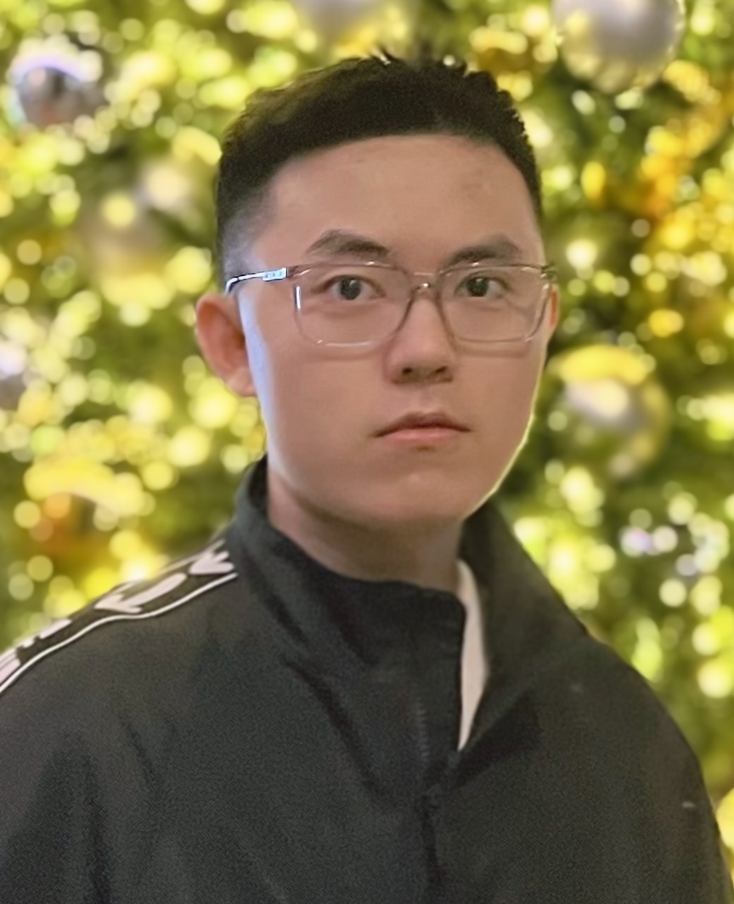

# Yifan Liu（刘异凡）

  

    
  

  

    

      I am a Ph.D. candidate in Condensed Matter Theory at <a href="https://www.ucr.edu/" target="_blank" rel="noopener">the University of California, Riverside</a>, advised by <a href="https://profiles.ucr.edu/app/home/profile/vivekj" target="_blank" rel="noopener">Prof. Vivek Aji</a>.
      Prior to joining UCR, I received my B.S. in Physics from <a href="https://physics.bit.edu.cn/en/" target="_blank" rel="noopener">Beijing Institute of Technology</a> in 2018.
      My research interests include strongly correlated electronic systems, moiré materials, and non-Hermitian physics.
    

    
    

      I am currently studying twisted bilayer graphene and other moire materials with a focus on electron-phonon coupling and its implications for correlated phases.
    

    

      Outside of physics, I enjoy hiking, cooking, and classical music.
    

    <!-- 

      <a href="mailto:yliu545@ucr.edu">Email</a> |
      <a href="https://scholar.google.com/citations?user=mXwRRVQAAAAJ&hl=en&authuser=1" target="_blank">Google Scholar</a> |
      <a href="https://github.com/lyfstefan" target="_blank">GitHub</a>
    
 -->

  

:material-email: [Email](mailto:yliu545@ucr.edu) | :material-school: [Google Scholar](https://scholar.google.com/citations?user=mXwRRVQAAAAJ&hl=en&authuser=1) | :fontawesome-brands-github: [GitHub](https://github.com/lyfstefan)

## Research Interests

  
Strongly correlated systems

  
Moiré materials

  
Electron-phonon coupling

  
Twisted bilayer graphene and TMDs

  
Non-Hermitian systems

## Publications

1. **Y. Liu**, V. Aji,  
   [*Bond ordering in flux phases of interacting spinless fermions on the square lattice*](https://journals.aps.org/prb/abstract/10.1103/PhysRevB.113.045140),  
   **Physical Review B** **113**, 045140 (2026).

2. **Y. Liu**, R. Dawson, N. Gabor, V. Aji,  
   [*Phonon-assisted absorption in transition metal dichalcogenide heterostructures*](https://arxiv.org/abs/2602.02803),  
   arXiv:2602.02803 (2026).

3. **Y. Liu**, V. M. Aji,  
   *Fluctuations of loop current order*,  
   in preparation.

4. R. Zhang, **Y. F. Liu**, T. Chen,  
   [*Non-Hermiticity-induced quantum control of localization in quantum walks*](https://journals.aps.org/pra/abstract/10.1103/PhysRevA.102.022218),  
   **Physical Review A** **102**(2), 022218 (2020).

<!-- 

1. **Y. Liu**, V. Aji,  
   [*Bond ordering in flux phases of interacting spinless fermions on the square lattice*](https://journals.aps.org/prb/abstract/10.1103/PhysRevB.113.045140),  
   **Physical Review B** **113**, 045140 (2026).

2. **Y. Liu**, R. Dawson, N. Gabor, V. Aji,  
   [*Phonon-assisted absorption in transition metal dichalcogenide heterostructures*](https://arxiv.org/abs/2602.02803),  
   arXiv:2602.02803 (2026).

3. **Y. Liu**, V. M. Aji,  
   *Fluctuations of loop current order*,  
   in preparation.

4. R. Zhang, **Y. F. Liu**, T. Chen,  
   [*Non-Hermiticity-induced quantum control of localization in quantum walks*](https://journals.aps.org/pra/abstract/10.1103/PhysRevA.102.022218),  
   **Physical Review A** **102**(2), 022218 (2020).

 -->

## Talks and Conferences

1. **Y. Liu**, V. Aji,  
   *Moiré electron-phonon coupling in vdW heterostructures*,  
   QuVET Center Talk, October 9, 2025.
   
2. **Y. Liu**, R. Dawson, V. Aji,   
   *Phonon Assisted Absorption: A Non-perturbative Approach*,  
   QuVET Center Talk, April 3, 2025.  
   [Slides](files/slides/quvet_2025.pdf)

3. **Y. Liu**, V. M. Aji,  
   *Fluctuations of loop current order*,  
   **SMT 2025**, March 18, 2025.

4. **Y. Liu**, V. Aji,  
   *Bond ordering in flux phases*,  
   APS March Meeting 2024, March 5, 2024.   
   [Slides](files/slides/bond_ordering_aps2024.pdf)

5. V. Aji, **Y. Liu**, R. Dawson,  
   *Phonon assisted absorption in Transition Metal Dichalcogenides heterostructures*,  
   APS March Meeting 2024, March 5, 2024.