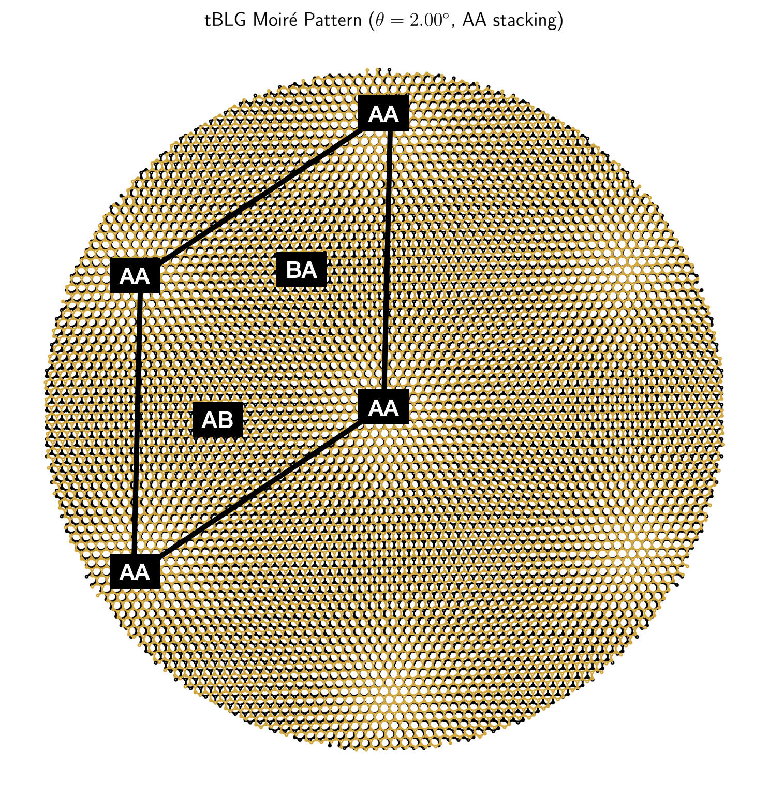
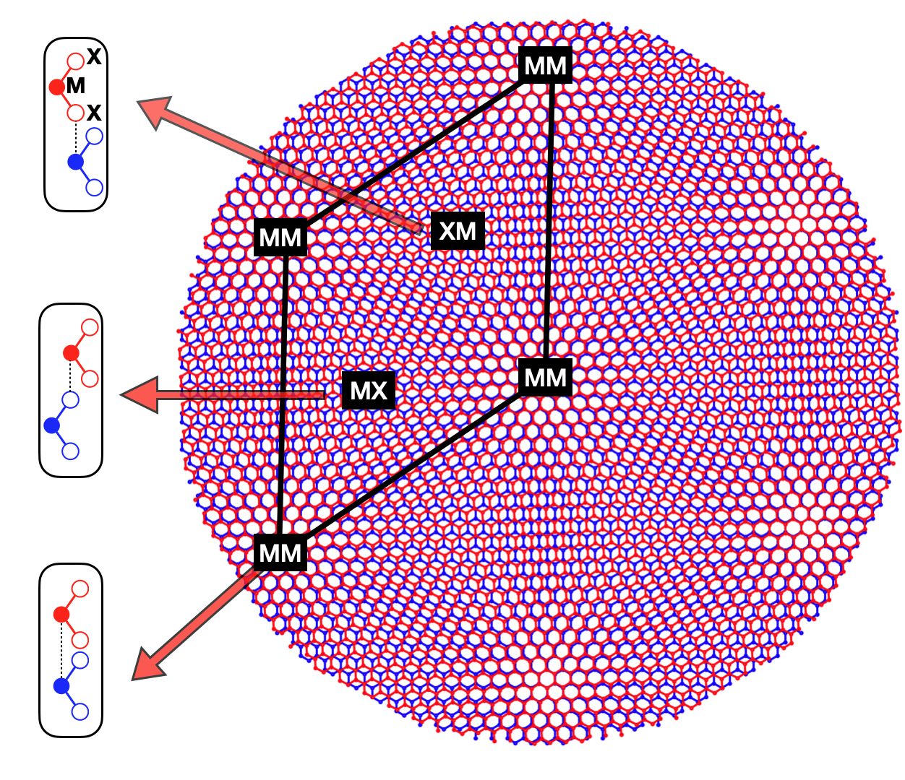
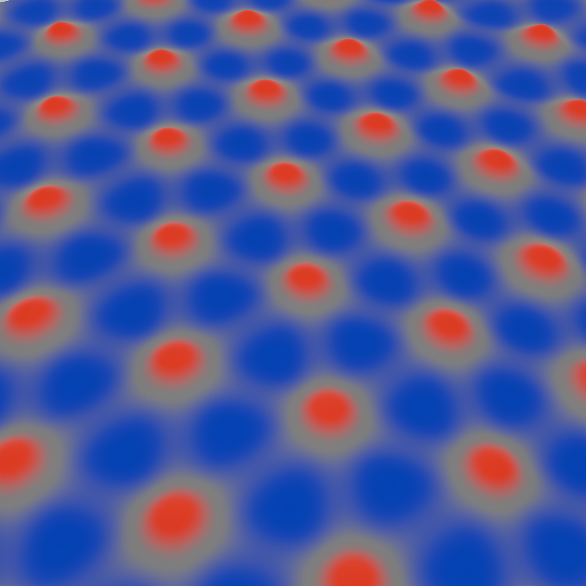

# Research

My research is in theoretical condensed matter physics, with a focus on interaction-driven phenomena in quantum materials. I am particularly interested in moiré systems, electron-phonon coupling, strongly correlated electronic phases, and non-Hermitian effects in quantum systems.

## Moiré materials and electron-phonon coupling

  

    

      
      
      
    

    <button class="slider-btn prev" onclick="changeSlide('slider-moire', -1)">❮</button>
    <button class="slider-btn next" onclick="changeSlide('slider-moire', 1)">❯</button>

    

      
      
      
    

  

  

    

      A central part of my research concerns moiré materials and van der Waals heterostructures,
      especially twisted bilayer systems and transition metal dichalcogenide heterostructures.
      I study how lattice degrees of freedom couple to electronic states, and how electron-phonon
      interactions shape optical response, excitation processes, and correlated phases in
      low-dimensional materials.
    

  

## Strongly correlated phases and ordering phenomena

I also work on interaction-driven ordering in lattice models of correlated electrons. My recent work includes bond ordering in flux phases, loop current fluctuations, and related broken-symmetry states. More broadly, I am interested in how interactions generate competing ordered phases and how these phases can be characterized theoretically.

## Non-Hermitian quantum systems

Another direction of my research is non-Hermitian physics. In this context, I study how non-Hermitian structure modifies localization, dynamics, and quantum control in model systems, and how these effects can lead to qualitatively new physical behavior beyond conventional Hermitian settings.